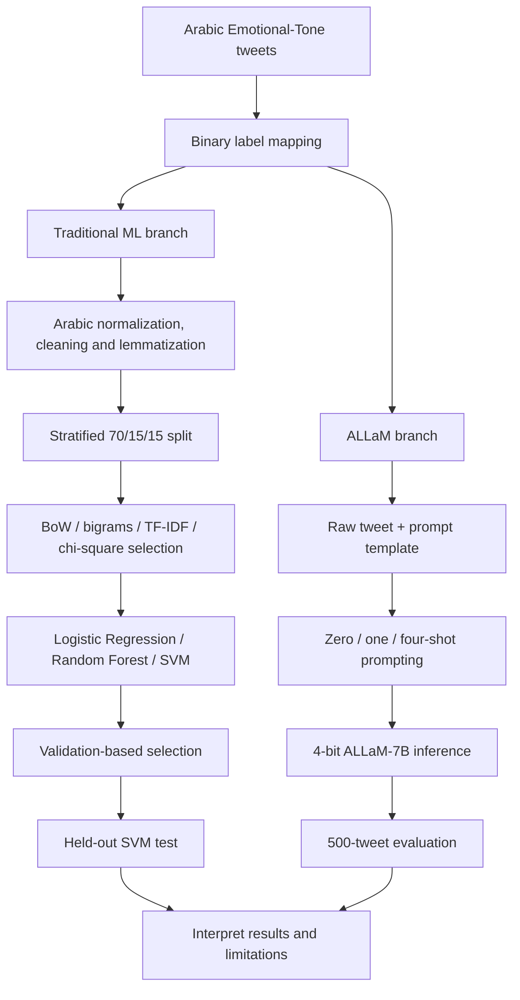
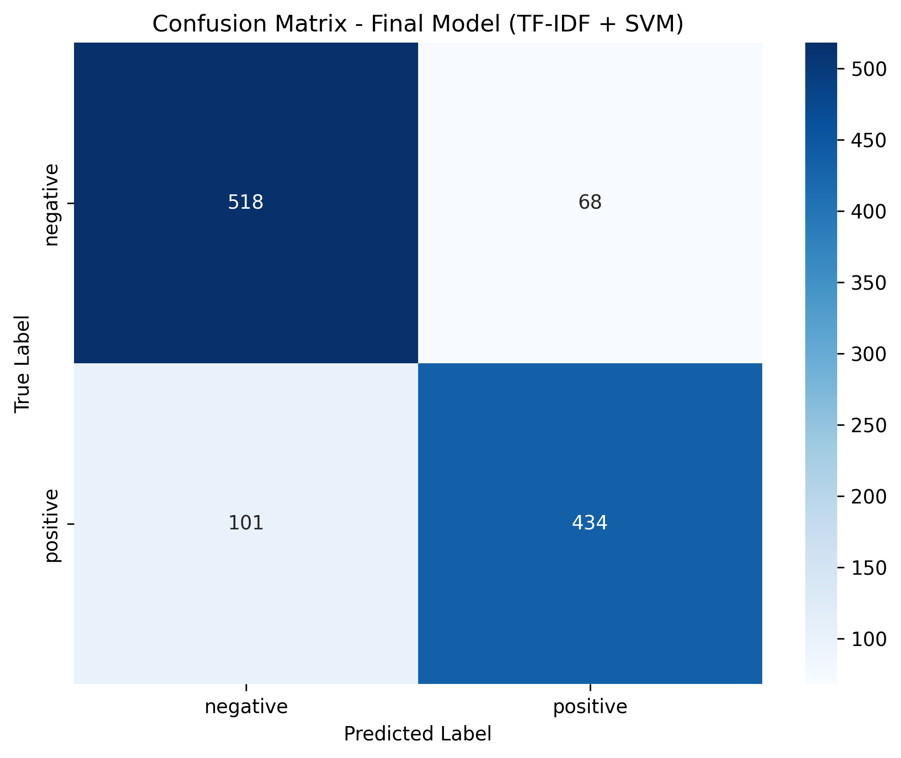
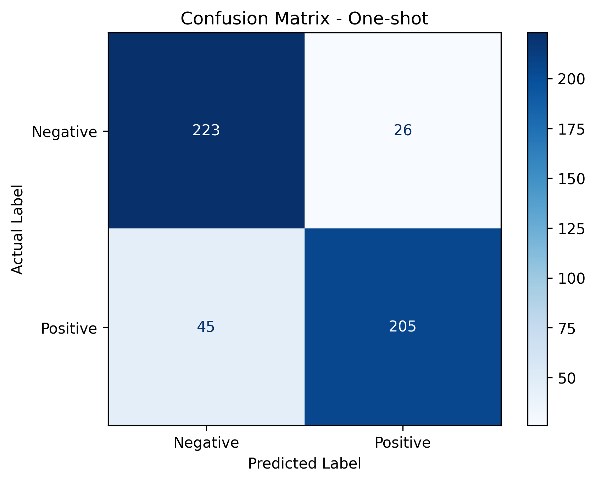

# Arabic-Sentiment-Classification-Traditional-NLP-vs-LLM

**A comparative study of feature-engineered machine learning and prompt-based large language models for sentiment classification of Arabic tweets.**

`Python` · `Arabic NLP` · `scikit-learn` · `CAMeL Tools` · `TF-IDF` · `SVM` · `ALLaM-7B` · `Hugging Face Transformers`

## Overview

Arabic social-media text is challenging for automated classification because of dialect variation, rich morphology, informal spelling and context-dependent expressions. This project examines a practical engineering question: **How competitive are conventional text classifiers against an Arabic-focused instruction-tuned LLM on binary sentiment classification?**

We implemented and evaluated two approaches:

- **Traditional ML:** Arabic text normalization and lemmatization, four feature representations, and three supervised classifiers (12 configurations).
- **LLM inference:** Zero-shot, one-shot and four-example few-shot prompting using **[ALLaM-7B-Instruct-preview](https://huggingface.co/ALLaM-AI/ALLaM-7B-Instruct-preview)**, without fine-tuning.

**Main finding:** A linear SVM with TF-IDF achieved **84.92% accuracy** and **84.89% weighted F1** on its held-out test set. The ALLaM prompting experiments reported **84–85% accuracy** on a separate 500-tweet sample. This suggests that a relatively simple feature-based baseline can be competitive on this task. **These numbers are not a controlled head-to-head comparison because the evaluation samples differ.**

## At a glance

| Item | Details |
| --- | --- |
| Task | Binary Arabic tweet sentiment classification |
| Data | Emotional-Tone Arabic tweets; 10,065 original records; 7,469 retained after label mapping |
| Labels | Positive / Negative (mapped from six emotion labels) |
| Classical models | Logistic Regression, Random Forest (100 trees), linear-kernel SVM |
| Feature variants | Bag of Words, word bigrams, TF-IDF (1–2 grams), top-300 chi-square-selected TF-IDF features |
| LLM | ALLaM-7B-Instruct-preview, 4-bit quantized inference |
| Classical split | Stratified 70% train / 15% validation / 15% test |
| LLM evaluation | First 500 mapped records; separate from classical held-out test |

## Motivation and research questions

Sentiment in Arabic is not always captured by direct keyword matching: dialects, morphological variants and negation can change meaning. The experiment investigates:

1. Which classical feature representation and classifier perform best on the reduced binary task?
2. How much does an Arabic-specific preprocessing pipeline contribute to a usable ML workflow?
3. How do zero-, one- and few-shot prompting compare for ALLaM?
4. When is a compact classical model a credible alternative to a larger generative model?

## Data and label design

**Source:** [Emotional-Tone dataset repository](https://github.com/amrmalkhatib/Emotional-Tone) and its [CSV](https://raw.githubusercontent.com/amrmalkhatib/Emotional-Tone/master/Emotional-Tone-Dataset.csv). The dataset contains Arabic tweets and original emotion labels. We converted it to a binary sentiment task:

| Positive | Negative | Excluded |
| --- | --- | --- |
| `joy`, `love`, `sympathy` | `anger`, `sadness`, `fear` | `none`, `surprise` |

The resulting corpus contained **3,562 positive** and **3,907 negative** tweets (**7,469 total**). The original dataset had one missing tweet and approximately 14.5 words per tweet on average. The report identifies **44 duplicated tweets**, including **8 tweets associated with conflicting labels**; they were not deduplicated in the original experiment.

**Scope:** The project predicts *positive versus negative sentiment* after mapping emotion labels. It does **not** perform eight-class emotion recognition, and the mapped labels are not interchangeable with the original emotion categories.

## Architecture and experimental workflow

The two branches intentionally differ: classical ML learns from vectorized, preprocessed text; ALLaM receives the original tweet in a prompt and generates a label without parameter updates.

### Traditional NLP branch

1. **Explore and clean:** inspect missing values, duplicates, class counts and tweet lengths. Normalize Unicode and Arabic letter variants, remove diacritics, punctuation, symbols, digits and Latin letters.
2. **Tokenize and normalize morphology:** remove Arabic stopwords and use **CAMeL Tools** morphological disambiguation to derive lemmas. A custom stemmer was also explored, but **lemmatized text** was used for the final ML features.
3. **Vectorize:** compare unigram Bag of Words, word bigrams, TF-IDF unigrams/bigrams, and chi-square selection of the 300 highest-scoring TF-IDF features. Fit vectorizers and the selector on the training split only.
4. **Train and select:** evaluate three classifiers against each representation using validation accuracy, precision, recall and weighted F1.
5. **Test:** select **linear SVM + TF-IDF** and evaluate on the held-out test partition.

**Preprocessing trade-off:** Removing stopwords and punctuation reduces noise but can discard negation and sentiment-bearing cues. This is a limitation worth testing in an ablation study.

### LLM branch

We loaded `ALLaM-AI/ALLaM-7B-Instruct-preview` with **4-bit NF4 quantization** through Transformers/bitsandbytes and asked it to output one of two English labels: `Positive` or `Negative`. Three prompting configurations were studied:

| Strategy | Context provided |
| --- | --- |
| Zero-shot | Task instructions only |
| One-shot | Task instructions plus one positive example |
| Few-shot | Task instructions plus four examples (two positive, two negative) |

The model was used for inference only: **no fine-tuning or weight updates**. The code uses different generation settings and response-parsing implementations across prompting runs; these differences limit how confidently prompt-count effects can be isolated.

## Results

### Traditional models: validation set

The original experiment compared **12 model–feature combinations**. The top configurations by weighted F1 were:

| Feature representation | Classifier | Accuracy | Weighted F1 |
| --- | --- | ---: | ---: |
| **TF-IDF** | **Linear SVM** | **85.36%** | **85.35%** |
| Bag of Words | Logistic Regression | 83.12% | 83.13% |
| TF-IDF | Logistic Regression | 82.68% | 82.64% |
| Bag of Words | Linear SVM | 81.07% | 81.08% |
| TF-IDF | Random Forest | 80.89% | 80.90% |

The full comparison also included Bag of Words + Random Forest, three chi-square-selected feature configurations, and three word-bigram configurations. Linear SVM + TF-IDF ranked highest on validation and was selected for final testing.

### Selected classical model: held-out test

| Metric | Result |
| --- | ---: |
| **Accuracy** | **84.92%** |
| **Weighted F1** | **84.89%** |
| Weighted precision | 85.01% |
| Weighted recall | 84.92% |
| Test support | 1,121 tweets |

The negative class achieved approximately **0.88 recall** and the positive class approximately **0.81 recall**. In the confusion matrix, 518 negative and 434 positive tweets were classified correctly; 68 negatives and 101 positives were misclassified. This indicates a greater tendency to miss positive examples.

### ALLaM prompting experiments

The report summarizes the following results on **500 mapped tweets**:

| Prompting strategy | Accuracy | Reported F1 |
| --- | ---: | ---: |
| Zero-shot | 85% | 0.86 |
| One-shot | 85% | 0.86 |
| Few-shot (4 examples) | 84% | 0.85 |

**Interpretation:** In the reported experiments, more prompt examples did not consistently improve results. However, rounded metrics, differing decoding/parsing logic and possible overlap between few-shot demonstrations and evaluated data mean this should be treated as an exploratory observation, not a causal conclusion.

### Comparing the approaches responsibly

The classical SVM achieved a competitive score despite using sparse vector representations and a conventional supervised learner. ALLaM performed similarly without task-specific training. **Because the classical and LLM branches were not evaluated on the same test instances, the reported percentage difference does not establish superiority.** Runtime, GPU memory and inference cost were not measured, so resource-efficiency claims remain qualitative.

## Tech stack and design choices

| Tool | Role |
| --- | --- |
| Python, pandas | Dataset inspection, cleaning and experiment organization |
| CAMeL Tools, PyArabic | Arabic-aware normalization, diacritic removal and morphological processing |
| NLTK | Arabic stopword list |
| scikit-learn | Feature extraction, chi-square selection, classical classifiers, splitting and metrics |
| Transformers, Hugging Face Hub | Tokenization, model loading and generative inference |
| PyTorch, bitsandbytes, Accelerate | GPU inference and 4-bit quantization |
| Matplotlib, seaborn | Class distribution and confusion-matrix visualizations |

## Limitations and next steps

**Known limitations**

- Eight original emotion categories were collapsed into binary sentiment; nuance from `surprise` and `none` was excluded.
- The LLM and classical results were collected on different evaluation samples.
- LLM prediction extraction and generation settings varied by prompting strategy.
- No measured latency, memory, throughput or cost comparison was performed.

**Proposed improvements**

1. Benchmark both branches on the **same** untouched test set with fixed seeds and strict label parsing.
2. Add macro F1, confidence intervals, per-dialect analysis and error categorization.
3. Measure inference latency, GPU memory and throughput for practical deployment trade-offs.

## References

- Al-Khatib, A., & El-Beltagy, S. R. (2017). *Emotional tone detection in Arabic tweets*. CICLing.
- [Emotional-Tone dataset source](https://github.com/amrmalkhatib/Emotional-Tone)
- [ALLaM-7B-Instruct-preview model card](https://huggingface.co/ALLaM-AI/ALLaM-7B-Instruct-preview)
- [CAMeL Tools documentation](https://camel-tools.readthedocs.io/en/latest/)
- [scikit-learn documentation](https://scikit-learn.org/stable/)
